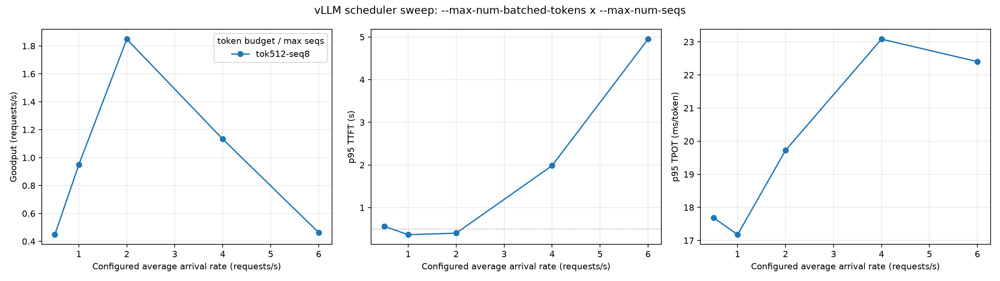

# vLLM scheduler sweep

I wanted to see how vLLM's scheduler settings change latency and throughput when short chat requests and long-prompt requests arrive together. This repo serves a small model with vLLM, replays the same request traces at increasing arrival rates, and compares six scheduler configs.

Everything runs on one laptop GPU, so the absolute numbers are small. The point is the shape of the curves and how they change between configs.

## Setup

| | |
|---|---|
| GPU | NVIDIA RTX 4060 Laptop, 8 GB |
| Server | vLLM 0.32.0, continuous batching and chunked prefill (both on by default) |
| Model | Qwen/Qwen2.5-1.5B-Instruct, FP16, pinned revision `989aa79` |
| Server flags | `--max-model-len 4096 --gpu-memory-utilization 0.80` |

Configs swept:

- `--max-num-batched-tokens` (token budget per scheduler step): 512, 1024, 2048
- `--max-num-seqs` (max requests running at once): 8, 16

Each config gets a fresh server.

## Workload

Each trace has 60 requests with Poisson arrivals at 0.5, 1, 2, 4 and 6 requests/s:

- **80% short**: 180–320 prompt tokens, 96 output tokens
- **20% long**: 2200–2900 prompt tokens, 128 output tokens

Traces are generated with a fixed seed, so every config sees exactly the same requests at the same times. Requests use `temperature=0` and `ignore_eos=True`, so every request produces exactly the requested number of tokens.

A few things keep runs fair:

- Every prompt starts with a run tag, so one run can't reuse another run's prefix cache.
- Three warmup requests (one per class) are sent before the measured trace starts.
- The client is open-loop. Requests are sent on schedule whether or not earlier ones have finished, and the client records how late each send was.

## What gets measured

From the client (`lab2.py`), per request:

- **TTFT**: time to first token
- **TPOT**: average time per output token after the first
- **E2E**: total request latency
- **Goodput**: requests per second that meet both SLOs, TTFT ≤ 0.5 s and E2E ≤ 5 s

From the server and GPU (`monitor.py`, sampled during each run): GPU utilization, vLLM process CPU, KV cache usage, queue time, preemptions and token counters from vLLM's `/metrics`.

## Results



**Goodput (req/s) and p95 TTFT at each arrival rate**

| config | 2 req/s | 4 req/s | 6 req/s |
|---|---|---|---|
| tok512-seq8 | 1.85 / 0.40 s | 1.13 / 1.98 s | 0.46 / 4.95 s |
| tok1024-seq8 | 1.85 / 0.37 s | 1.07 / 2.00 s | 0.46 / 5.00 s |
| tok2048-seq8 | 1.85 / 0.37 s | 0.89 / 2.10 s | 0.46 / 5.12 s |
| tok512-seq16 | 1.85 / 0.41 s | 3.22 / 0.53 s | 2.79 / 1.28 s |
| tok1024-seq16 | 1.85 / 0.37 s | 3.34 / 0.42 s | 2.79 / 1.29 s |
| tok2048-seq16 | 1.85 / 0.37 s | 3.34 / 0.46 s | 2.63 / 1.32 s |

**Throughput and server state at 6 req/s**

| config | completed req/s | output tok/s | p95 TPOT | avg queue time | peak KV cache |
|---|---|---|---|---|---|
| tok1024-seq8 | 3.45 | 354 | 23.2 ms | 2672 ms | 10% |
| tok1024-seq16 | 4.78 | 490 | 31.4 ms | 362 ms | 16% |

The full tables for every config and rate are printed by `plot_sweep.py`. Per-run plots over time are in `plots/monitor/`.

### What I found

1. **Up to 2 req/s, the configs perform the same.** The server keeps up, nothing queues, and every request meets the SLO.

2. **`max-num-seqs` is the setting that matters.** At 4 req/s, the seq8 configs hit their concurrency cap. Requests wait in the queue (~800 ms on average), p95 TTFT rises to about 2 s, and goodput falls to about 1 req/s. With seq16, p95 TTFT stays near 0.5 s and goodput is about 3.3 req/s. At 6 req/s, seq8 tops out at ~3.45 completed req/s while seq16 completes ~4.8 req/s.

3. **More concurrency costs decode speed.** With 16 sequences sharing each step, p95 TPOT goes from ~23 ms to ~28–31 ms. For this workload that's a good trade, because the queueing delay it removes is far larger.

4. **The token budget barely matters here.** Between 512, 1024 and 2048 the differences are small. The 512 budget had slightly worse TTFT at 4 req/s (0.53 s vs 0.42 s), probably because each long prompt is split into about 5 prefill chunks instead of 1–2.

5. **Memory was never the bottleneck.** KV cache usage peaked at 16%, and there were zero preemptions in every run. A 1.5B model on 8 GB has plenty of cache room, so the limits here are the concurrency cap and compute. GPU utilization stayed around 74–86% under load.

### Caveats

- 60 requests per run is a small sample. p95 is based on only a few requests, so small differences between configs, like those in finding 4, may be noise.
- TPOT is averaged per request, which hides individual decode stalls. Chunked prefill is supposed to reduce exactly those stalls, so the token budget may matter more than this data shows. Measuring the gap between every pair of tokens is the next thing I want to add.
- At 0.5 req/s, TTFT is slightly higher than at 1 req/s. My guess is the laptop GPU clocking down between sparse requests, but I haven't confirmed it.
- The monitor's vLLM counters were added partway through, so `tok512-seq8` has no queue or preemption data.

## Running it

Requirements: Python with `vllm==0.32.0`, `aiohttp`, `transformers`, `psutil`, `pynvml` and `matplotlib` in `.venv/`.

Generate a trace (the ones in `traces/` were made this way, seed 42):

```bash
python lab2.py generate --family mixed --rate 1 --n 60 --output traces/mixed-rate-1.jsonl
```

Run the full sweep (starts and stops vLLM for each config, then plots):

```bash
SWEEP_DIR=results/sweep-mon ./sweep.sh
```

Or replay a single trace against a server that's already running:

```bash
python lab2.py replay --trace traces/mixed-rate-2.jsonl --output results/test.jsonl
python lab2.py report --results results/test.jsonl
```

## Files

| file | what it does |
|---|---|
| `lab2.py` | trace generator, async replay client, quick report |
| `monitor.py` | samples GPU, CPU and vLLM `/metrics` into a CSV |
| `sweep.sh` | runs every config × rate combination |
| `plot_sweep.py` | summary tables and sweep plots |
| `plot_monitor.py` | per-run metric plots over time |
| `traces/` | request traces |
| `results/sweep-mon/` | raw per-request results and monitor CSVs |
| `plots/` | generated figures |
